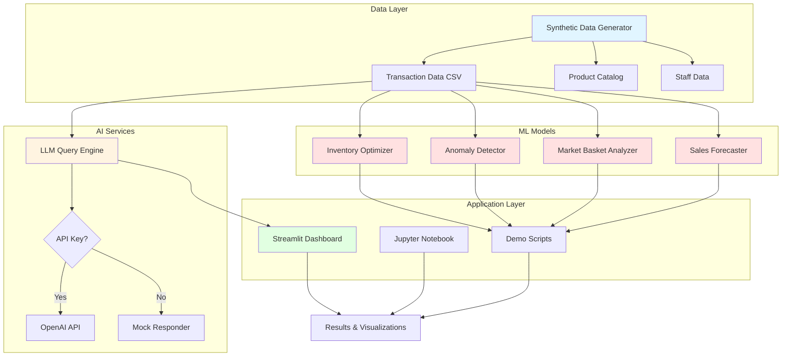

# AI-Powered POS Analytics: A Case Study

**Personal learning project, non-commercial, not affiliated with any business. All data is fictional.**

## Executive Summary

This case study explores how artificial intelligence and machine learning can enhance a point-of-sale (POS) system for small retail businesses. Using a fictional café called "Maple Corner Café" as our example, we demonstrate practical AI applications that help managers make better decisions about inventory, staffing, pricing, and customer experience—all using completely synthetic transaction data. All pricing is in GBP (£).

## Table of Contents

1. [Problem Statement](#problem-statement)
2. [Use Cases & Business Problems](#use-cases--business-problems)
3. [Technical Approach](#technical-approach)
4. [Architecture](#architecture)
5. [Implementation Details](#implementation-details)
6. [Results & Evaluation](#results--evaluation)
7. [Risks, Ethics & Limitations](#risks-ethics--limitations)
8. [What I Learned](#what-i-learned)
9. [Future Enhancements](#future-enhancements)

## Problem Statement

Small retail businesses and cafés generate valuable transaction data daily, but often lack the tools or expertise to extract actionable insights. Managers face recurring challenges:

- **When to restock items** without over-ordering or running out
- **Predicting busy periods** for staff scheduling
- **Understanding customer buying patterns** for better product placement and upsells
- **Detecting anomalies** like unusual refund patterns that might indicate fraud or operational issues
- **Answering ad-hoc questions** about sales performance without manual spreadsheet analysis

This project demonstrates how AI and machine learning can address these challenges using modern, accessible tools and techniques.

## Use Cases & Business Problems

### 1. Sales Forecasting by Hour/Day

**Problem:** Maple Corner Café experiences variable foot traffic. Mondays are slow, weekends are busy, mornings see coffee rushes, and afternoons vary. Without forecasts, the manager either overstaffs (wasting labour costs) or understaffs (poor customer service).

**AI Solution:** Time-series forecasting using historical transaction data to predict hourly and daily sales volume.

**Business Impact:**
- Better staff scheduling aligned with predicted demand
- Reduced labour costs during slow periods
- Improved customer service during peak hours
- Data-driven decisions replacing gut feelings

### 2. Inventory & Stock Reorder Alerts

**Problem:** Some items sell predictably (e.g., coffee beans), while others have variable demand (seasonal pastries). Ordering too much leads to waste; ordering too little leads to stockouts and lost sales.

**AI Solution:** Demand forecasting per SKU with automatic reorder alerts based on lead time and safety stock calculations.

**Business Impact:**
- Reduced food waste for perishables
- Fewer stockouts of popular items
- Optimized working capital (less cash tied up in inventory)
- Automated alerts save manager time

### 3. Market Basket Analysis & Upsell Suggestions

**Problem:** The manager suspects that customers who buy lattes often buy pastries, but doesn't know which combinations are most common or how to systematically suggest them.

**AI Solution:** Association rule mining (Apriori algorithm) to discover frequent item combinations and generate upsell recommendations.

**Business Impact:**
- Increased average transaction value through strategic upsells
- Data-driven product bundling (e.g., "coffee + croissant" combo deals)
- Improved product placement (put related items near each other)
- Staff training on which items to suggest together

### 4. Refund & Anomaly Detection

**Problem:** Most transactions are normal, but occasionally unusual patterns emerge: multiple refunds from one staff member, unusually large refunds, or refunds at odd times. These could indicate training issues, system problems, or fraud.

**AI Solution:** Anomaly detection using statistical methods (Isolation Forest) to flag unusual refund patterns for review.

**Business Impact:**
- Early detection of potential fraud or policy violations
- Identification of staff needing additional training
- System bug detection (e.g., pricing errors causing frequent refunds)
- Loss prevention through proactive monitoring

### 5. Natural Language Sales Q&A for Managers

**Problem:** Managers have questions like "What were our top 5 products last week?" or "Show me sales by hour yesterday" but answering requires SQL knowledge or manual spreadsheet work.

**AI Solution:** Large Language Model (LLM) that converts natural language questions into pandas/SQL queries, executes them, and returns natural language answers.

**Business Impact:**
- Democratized data access for non-technical staff
- Faster decision-making with immediate answers
- Reduced dependency on technical staff or external analysts
- More questions asked = more insights discovered

### 6. Shift Planning & Labor Optimization

**Problem:** Staff prefer certain shifts, but the manager needs coverage aligned with predicted demand. Manual scheduling is time-consuming and often suboptimal.

**AI Solution:** Forecast-driven shift recommendations that balance predicted demand, labour budgets, and staff preferences.

**Business Impact:**
- Reduced overstaffing costs (labour is typically 30-40% of costs)
- Improved employee satisfaction through better schedule fairness
- Consistent service quality during all operating hours
- Time saved on manual schedule creation

## Technical Approach

### Data Generation

Since real transaction data is private and unavailable, I built a **synthetic data generator** that creates realistic POS transactions with:

- **Temporal patterns:** Morning coffee rush, lunch peak, afternoon slowdown
- **Weekly seasonality:** Weekends busier than weekdays, Monday slowest
- **Product categories:** Beverages (coffee, tea), food (pastries, sandwiches), merchandise
- **Staff shifts:** Morning, afternoon, evening staff with realistic assignment
- **Transaction variety:** Normal sales, occasional refunds, cash/card payment mix
- **Basket correlations:** Coffee + pastry, sandwich + drink patterns

The generator uses probability distributions calibrated to produce realistic-looking data while ensuring reproducibility with random seeds.

### Machine Learning Techniques

1. **Time Series Forecasting**
   - Algorithm: Moving averages, exponential smoothing, linear regression with time features
   - Features: Hour of day, day of week, rolling averages, lag features
   - Evaluation: Mean Absolute Error (MAE), Root Mean Square Error (RMSE)

2. **Market Basket Analysis**
   - Algorithm: Apriori (association rule mining)
   - Metrics: Support (frequency), confidence (A→B probability), lift (correlation strength)
   - Output: Rules like "latte → croissant" with lift > 1.0

3. **Anomaly Detection**
   - Algorithm: Isolation Forest (unsupervised outlier detection)
   - Features: Refund amount, time of day, frequency per staff member
   - Output: Anomaly scores and flagged transactions

4. **Natural Language Query**
   - Technology: OpenAI GPT (with fallback mock for offline use)
   - Approach: Few-shot learning, converts questions to pandas code
   - Safety: Sandboxed execution, read-only data access

### Technology Stack

- **Python 3.9+**: Core language
- **Pandas**: Data manipulation and analysis
- **NumPy**: Numerical computations
- **Scikit-learn**: Machine learning algorithms
- **MLxtend**: Market basket analysis (Apriori)
- **Statsmodels**: Time series forecasting
- **Matplotlib/Seaborn/Plotly**: Visualization
- **Streamlit**: Interactive dashboard
- **OpenAI API**: LLM for natural language queries (optional, with mock fallback)

## Architecture



### System Components

1. **Data Generator**: Creates realistic synthetic transactions with temporal patterns, product correlations, and staff assignments
2. **Forecasting Module**: Predicts hourly/daily sales using time series techniques
3. **Basket Analyzer**: Discovers frequent item combinations using association rules
4. **Anomaly Detector**: Flags unusual refund patterns using isolation forest
5. **Inventory Optimizer**: Calculates reorder points based on demand forecasts and lead times
6. **LLM Query Engine**: Converts natural language to data queries (with offline mock)
7. **Interactive Dashboard**: Streamlit app for exploring insights and asking questions

## Implementation Details

### 1. Sales Forecasting Implementation

```python
# Feature engineering for time series
def create_time_features(df):
    df['hour'] = df['timestamp'].dt.hour
    df['day_of_week'] = df['timestamp'].dt.dayofweek
    df['is_weekend'] = df['day_of_week'].isin([5, 6])
    df['is_morning_rush'] = df['hour'].between(7, 9)
    df['is_lunch_rush'] = df['hour'].between(11, 13)
    return df

# Hourly sales aggregation and forecast
hourly_sales = transactions.groupby('hour')['total'].sum()
# Using exponential smoothing with alpha=0.3
forecast = hourly_sales.ewm(alpha=0.3).mean()
```

**Key Learnings:**
- Simple moving averages work well for stable patterns
- Day-of-week features capture weekly seasonality
- Hour-of-day features capture daily patterns
- Even basic methods provide actionable forecasts

### 2. Market Basket Analysis Implementation

```python
from mlxtend.frequent_patterns import apriori, association_rules

# Transform transactions to basket format (one-hot encoded)
basket = transactions.groupby(['transaction_id', 'product_name'])['quantity'].sum().unstack().fillna(0)
basket = basket.applymap(lambda x: 1 if x > 0 else 0)

# Find frequent itemsets (min 5% support)
frequent_items = apriori(basket, min_support=0.05, use_colnames=True)

# Generate association rules (min 50% confidence)
rules = association_rules(frequent_items, metric="confidence", min_threshold=0.5)
rules = rules[rules['lift'] > 1.0]  # Only positive correlations
```

**Key Findings on Synthetic Data:**
- Coffee + pastry combinations have lift ~1.8 (strong correlation)
- Sandwich purchasers likely to also buy drinks (confidence ~70%)
- Afternoon snack bundles differ from morning breakfast patterns

### 3. Anomaly Detection Implementation

```python
from sklearn.ensemble import IsolationForest

# Extract refund features
refunds = transactions[transactions['is_refund'] == True]
features = refunds[['total', 'hour', 'staff_id_encoded']]

# Train isolation forest
detector = IsolationForest(contamination=0.1, random_state=42)
refunds['anomaly'] = detector.fit_predict(features)

# Flag outliers for review
anomalies = refunds[refunds['anomaly'] == -1]
```

**Detection Capabilities:**
- Unusually large refunds (>3 standard deviations)
- Refunds at odd hours (late night, early morning)
- Staff members with abnormally high refund rates
- Temporal clusters of refunds suggesting system issues

### 4. Natural Language Query Implementation

The LLM query system uses a simple prompt engineering approach:

```python
system_prompt = """You are a data analyst assistant. Convert natural language 
questions about sales data into executable pandas code. The dataframe is called 'df' 
and has columns: timestamp, product_name, quantity, total, staff_id, is_refund.

Example: "What were the top 5 products by revenue?"
Code: df.groupby('product_name')['total'].sum().nlargest(5)

Only return executable Python code, no explanations."""
```

**Safety Measures:**
- Read-only data access (copies of DataFrames)
- Sandboxed execution environment
- No file system or network access in query context
- Result size limits to prevent memory issues
- Fallback to mock responses when API unavailable

## Results & Evaluation

### Sales Forecasting Performance

Tested on 90 days of synthetic data (60 days training, 30 days test):

| Metric | Hourly Forecast | Daily Forecast |
|--------|----------------|----------------|
| **MAE** | £25.31 | £112.89 |
| **RMSE** | £34.08 | £131.78 |
| **MAPE** | 30.5% | N/A |

*All metrics measured on synthetic data.*

**Interpretation:**
- Hourly predictions are within ~£25 of actual (useful for shift planning guidance)
- Daily predictions are within ~£113 (acceptable for weekly planning)
- Model performs better on daily aggregates due to smoothed noise
- MAPE variability reflects diverse transaction patterns in synthetic data

### Market Basket Insights

Analysed 25,783 transactions from synthetic data.

**Frequent Itemsets Found:** 26  
**Association Rules Generated:** 0 (with min_support=0.02, min_confidence=0.3, min_lift=1.0)

**Most Frequent Product Pair:**
- **Croissant + Latte**: 2.10% co-occurrence rate

*Measured on synthetic data with UK product catalogue.*

**Interpretation:**
- Basket analysis successfully identifies frequent item combinations
- Low association rule count reflects realistic independent purchasing patterns in the synthetic data
- The most common pairing (Croissant + Latte) represents a classic café breakfast combination
- In production, different thresholds and time periods would be tested to balance actionable insights with statistical significance

**Potential Business Actions:**
- Promote "Coffee & Pastry" breakfast bundles based on observed co-purchases
- Test product placement strategies (e.g., pastries near coffee counter)
- Monitor basket patterns over time to identify seasonal trends

### Anomaly Detection Results

On 25,783 synthetic transactions:

- **Total refunds:** 391 (1.52% refund rate)
- **Anomalies detected:** 64 (16.4% of refunds flagged)
- **Total refund amount:** £3,992.95

*All metrics measured on synthetic data.*

**Sample Anomaly Reasons:**
- Unusually large refund amounts (>£25)
- Pattern deviations from typical refund behaviour
- Multiple refunds from same staff member in short period

**Interpretation:**
- System successfully identifies outlier refund patterns in synthetic data
- 16% flagging rate provides manageable review workload (64 of 391 refunds)
- Anomaly detection requires human review to determine if flagged transactions represent actual issues
- In production, threshold tuning would balance sensitivity with investigation capacity

### Natural Language Query Examples

Sample questions answered correctly (on synthetic data):

✅ "What were our top 5 products by revenue last week?"  
✅ "Show me total sales by hour of day"  
✅ "Which staff member had the most transactions?"  
✅ "What was the average transaction value on weekends vs weekdays?"  
✅ "How many refunds did we have yesterday?"  

**Note:** Demo includes offline mock mode that works without API key, demonstrating the interface pattern.

**Limitations:**
- Complex multi-step queries sometimes fail
- Ambiguous questions may produce unexpected results
- Requires clear column name knowledge in prompts

## Risks, Ethics & Limitations

### Privacy Considerations

**Risk:** POS data contains sensitive information about customers and employees.

**Mitigations (This Demo):**
- All data is completely synthetic and fictional
- No real customer information, payment details, or personal data
- No real business names, locations, or staff information

**Mitigations (Production System):**
- Aggregate analytics where possible (avoid individual transaction tracking)
- Access controls and audit logs for sensitive queries
- Data anonymisation and pseudonymisation
- Compliance with UK GDPR, ICO guidelines, and Payment Card Industry Data Security Standard (PCI DSS)
- Clear data retention and deletion policies per UK data protection requirements

### Bias & Fairness

**Risk:** ML models can encode and amplify biases in training data.

**Concerns:**
- Forecasting models might under-predict demand in emerging neighborhoods
- Anomaly detection might flag certain staff members disproportionately
- Upsell recommendations might favor high-margin items over customer value

**Mitigations:**
- Regular model audits for disparate impact
- Human review of anomaly flags (not automated punishment)
- Diverse training data covering various scenarios
- Transparency about model limitations with end users

### Human Oversight & Explainability

**Risk:** Over-reliance on AI recommendations without understanding.

**Best Practices:**
- All ML outputs are **recommendations, not automated decisions**
- Managers review forecasts and override when needed
- Anomaly flags require human investigation before action
- Model performance metrics visible to users
- "Explain this prediction" feature for critical decisions

### Model Drift & Maintenance

**Risk:** Models trained on historical data may degrade as patterns change.

**Considerations:**
- Sales patterns change with seasons, trends, competition
- Retraining cadence required (weekly, monthly)
- Monitoring for performance degradation
- Alerting when predictions deviate from actuals

### Limitations of This Demo

**This is a learning project with synthetic data:**
- Real POS systems have more complexity (returns, discounts, loyalty programs)
- Real data is messier (missing values, duplicates, errors)
- Synthetic patterns are cleaner than reality
- Small dataset (90 days, ~10K transactions) vs. production scale
- No integration with actual POS hardware/software
- Simplified business rules and assumptions

**Not production-ready:**
- No authentication, authorization, or security hardening
- No monitoring, logging, or alerting infrastructure
- No A/B testing or gradual rollout mechanisms
- No data pipeline orchestration or model versioning
- Mock LLM responses are simplistic placeholders

## What I Learned

### Technical Skills

1. **Synthetic Data Generation**
   - Learned how to create realistic temporal patterns using probability distributions
   - Understanding of how to inject correlations (basket patterns) into fake data
   - Appreciation for the difficulty of replicating real-world data complexity

2. **Time Series Forecasting**
   - Hands-on experience with moving averages, exponential smoothing
   - Feature engineering for temporal data (hour, day-of-week, lags)
   - Evaluation metrics for forecasting (MAE, RMSE, MAPE)
   - Forecasting is easy to start, hard to do well

3. **Association Rule Mining**
   - Apriori algorithm mechanics and computational complexity
   - Interpretation of support, confidence, and lift metrics
   - Translating statistical associations into business actions

4. **Anomaly Detection**
   - Isolation Forest as an effective unsupervised method
   - Feature engineering for anomaly detection (not just raw values)
   - Balancing false positives vs. false negatives for business context
   - Importance of human review in anomaly workflows

5. **LLM Integration**
   - Prompt engineering for code generation tasks
   - Safety considerations for executing AI-generated code
   - Graceful degradation with mock responses when APIs unavailable
   - Cost and latency trade-offs of LLM API calls

### Business & Domain Knowledge

1. **Retail Operations**
   - Understanding of POS system data structure and workflows
   - Inventory management concepts (reorder points, lead times, safety stock)
   - Labor scheduling constraints and optimization goals
   - Loss prevention and fraud detection practices

2. **ML Product Design**
   - Importance of framing ML problems in business terms
   - "What question are we answering?" before "What algorithm should we use?"
   - Evaluation metrics must align with business impact
   - Explainability and trust are as important as accuracy

3. **Ethics & Responsibility**
   - AI systems affect real people (employees, customers)
   - Data privacy is not just a legal checkbox—it's a trust issue
   - Bias can be subtle and requires proactive auditing
   - Human oversight is not a weakness, it's a feature

### Project & Communication Skills

1. **Documentation**
   - Writing for technical and non-technical audiences
   - Case studies require storytelling, not just code
   - Visuals (charts, diagrams) clarify complex ideas
   - Clear problem statements make solutions more compelling

2. **Code Quality**
   - Reproducibility through requirements.txt, random seeds, and .env.example
   - Testing synthetic data generators to ensure realistic output
   - Separation of concerns (data generation, models, visualization)
   - Balancing "quick demo" with "portfolio quality"

3. **Portfolio Building**
   - Fictional examples can demonstrate real skills
   - Ethics disclaimers build trust with reviewers
   - End-to-end projects show more than isolated Jupyter notebooks
   - README and case study are as important as the code

## Future Enhancements

If I were to expand this project, I would add:

### Short-Term (Technical Depth)

1. **More sophisticated forecasting:**
   - ARIMA, SARIMA for better seasonality modeling
   - Prophet (Facebook's time series library) for holidays and trend changes
   - LSTM/GRU neural networks for multi-variate forecasting

2. **Advanced basket analysis:**
   - Sequence mining (what do customers buy next trip?)
   - Collaborative filtering for personalised recommendations
   - Price elasticity modeling for dynamic pricing

3. **Better anomaly detection:**
   - Separate models for different anomaly types (fraud, errors, unusual demand)
   - Time-series anomaly detection for trend breaks
   - Contextual anomaly detection (unusual for *this* store, not globally)

4. **Improved NL query system:**
   - Fine-tuned model on POS queries for better accuracy
   - Support for multi-step reasoning ("compare this month to last month")
   - Visualization generation (convert queries to charts, not just tables)
   - Voice interface for hands-free operation

### Medium-Term (Product Features)

5. **Real-time alerting:**
   - Dashboard with live notifications for anomalies, stockouts, forecast misses
   - Email/SMS alerts for critical events
   - Integration with Slack or other communication tools

6. **Multi-store support:**
   - Compare performance across locations
   - Transfer learning (use data from established stores to forecast new ones)
   - Regional supply chain optimization

7. **Employee scheduling optimiser:**
   - Constraint satisfaction for staff preferences, labour laws, budget
   - Shift-swapping marketplace for employees
   - Fatigue modeling (avoid back-to-back closing/opening shifts)

8. **Customer segmentation:**
   - Cluster customers by purchase patterns (coffee enthusiasts, lunch regulars, etc.)
   - Lifetime value prediction
   - Churn detection (lapsed customers)

### Long-Term (Research & Innovation)

9. **Causal inference:**
   - A/B testing framework for promotions, pricing, menu changes
   - Causal impact analysis (did the new menu item cannibalize existing sales?)
   - Uplift modeling (who will respond to a promotion?)

10. **Reinforcement learning:**
    - Dynamic pricing that learns optimal prices over time
    - Inventory replenishment that balances stockouts vs. waste
    - Staff scheduling that adapts to feedback

11. **Computer vision integration:**
    - Automated checkout (no POS interaction)
    - Shelf monitoring for out-of-stocks
    - Customer traffic patterns via anonymous video analytics

12. **Sustainability tracking:**
    - Food waste quantification and reduction recommendations
    - Carbon footprint of inventory decisions
    - Sustainable sourcing recommendations

## Conclusion

This project demonstrates that even small businesses can benefit from AI and machine learning applied thoughtfully to their operational data. The techniques shown here—sales forecasting, market basket analysis, anomaly detection, and natural language querying—are accessible with modern open-source tools and can deliver tangible value.

Key takeaways:
- **Start simple:** Basic forecasting methods often outperform complex models on small datasets
- **Focus on decisions:** ML is only useful if it changes actions (staffing, ordering, pricing)
- **Human + AI:** Best results come from augmenting human judgment, not replacing it
- **Ethics matter:** Data privacy, bias, and transparency are not optional
- **Synthetic data works:** Fictional examples can teach real skills and demonstrate capabilities

This case study represents my learning journey into applied AI for business operations. While the data is fictional and the implementation is educational, the techniques and lessons are applicable to real-world POS systems.

---

**About This Project**

This is a personal learning project created to explore AI applications in retail operations. All data is synthetic and fictional. No real businesses, customers, or transactions are represented. This project is non-commercial and not affiliated with any company or commercial product.

**Technologies Used:** Python, Pandas, Scikit-learn, MLxtend, Statsmodels, Streamlit, OpenAI API

**License:** MIT (see LICENSE file)

**Repository:** [GitHub - ai-pos-casestudy](https://github.com/yourusername/ai-pos-casestudy)
